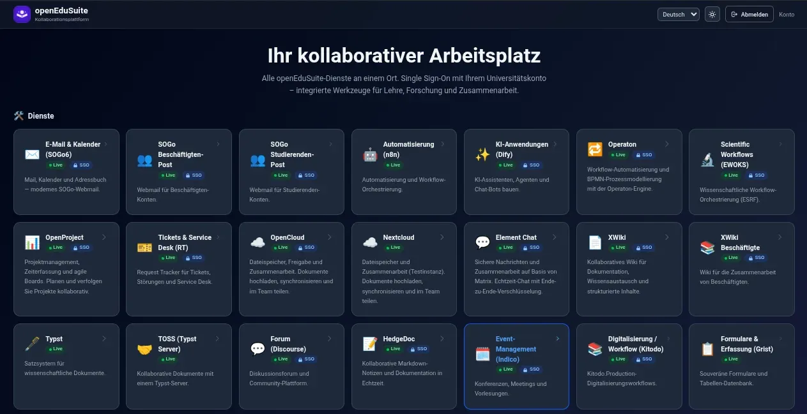

<!--
SPDX-FileCopyrightText: 2026 openEduSuite Contributors
SPDX-License-Identifier: Apache-2.0
-->

# openEduSuite

[](https://github.com/openEduSuite/openEduSuite-public/actions/workflows/ci.yml)
[](LICENSE)

**Ihr kollaborativer Arbeitsplatz** — alle openEduSuite-Dienste an einem Ort, mit
Single Sign-On über Ihr Hochschulkonto. **Your collaborative workspace** — all
openEduSuite services in one place, with single sign-on via your university
account. Based on [openDesk](https://github.com/Bundesdruckerei/opendesk).

This repository is the **public openEduSuite distribution**:

- a configurable **service portal** (SSO-aware dashboard, i18n de/en/fr/zh) and
- **sanitized deployment artifacts** for the whole app platform (helmfile
  trees, local Helm charts, GitOps wrappers) — all placeholders, ready to adopt.



## What's in this repo

| Path | What it is | Start here |
|------|------------|------------|
| `src/`, `public/`, `Dockerfile` | The **portal**: static React 19 / Vite / Tailwind SPA on nginx | [Portal quick start](#portal-quick-start) |
| `helmfile/` | **App deployment variants**: 27 services (ILIAS, Moodle, OpenCloud, SOGo, Zammad, …) as helmfile releases + charts | [`helmfile/README.md`](helmfile/README.md) |
| `argocd/` | **GitOps wrapper**: ArgoCD App-of-Apps, one `Application` per service, via the helmfile plugin | [`argocd/README.md`](argocd/README.md) |
| `kubara/` | **kubara support**: bootstraps ArgoCD + platform layer; apps ride the `argocd/` wrapper | [`kubara/README.md`](kubara/README.md) |
| `docs/` | Architecture (arc42 + C4) and portal configuration/deployment guides | [`docs/arc42/`](docs/arc42/README.md) |

## Portal quick start

```bash
npm ci && npm run dev     # dev server (Node.js 22+)
npm test                  # vitest suite (50 tests, incl. config-portability guard)
docker build -t openedusuite-portal . && docker run -p 8080:80 openedusuite-portal
```

The portal is a **static SPA with runtime config**: on boot it fetches
`/config.json` (mount yours as a Kubernetes ConfigMap); if the fetch fails it
falls back to bundled `example.org` placeholders.

Key behaviors:

- **SSO-aware** — probes `/oauth2/auth` behind oauth2-proxy: signed-out users
  see the landing page, signed-in users get tiles, staff section, widgets
- **Service tiles** — localized name/description, SSO badge, new-tab launch
- **Widgets** — weather iframe + news feeds, fetched same-origin through nginx
  (no CORS)
- **i18n** de/en/fr/zh with browser detection, **dark mode**, flat or
  category-grouped layout

## Documentation

| Topic | Where |
|-------|-------|
| Portal configuration reference (`/config.json`) | [`docs/portal-configuration.md`](docs/portal-configuration.md) |
| Portal deployment: Docker, Kubernetes, feed proxies, i18n, theming | [`docs/portal-deployment.md`](docs/portal-deployment.md) |
| App deployment variants (helmfile) + sanitization table | [`helmfile/README.md`](helmfile/README.md) |
| GitOps with ArgoCD (install CMP, App-of-Apps) | [`argocd/README.md`](argocd/README.md) |
| GitOps with kubara | [`kubara/README.md`](kubara/README.md) |
| Architecture (arc42, one file per section) + C4 models | [`docs/arc42/`](docs/arc42/README.md) |

## Deployment models

```
portal ──(npm/Docker/K8s)──▶              single page, your config
platform ──(helmfile)──▶                   all app services, imperative or CI
         ──(ArgoCD)──▶                     GitOps: App-of-Apps + helmfile CMP
         ──(kubara)──▶                     kubara provisions ArgoCD + platform layer
```

All three delivery paths render the **same helmfile tree**
(`helmfile/helmfile.yaml.gotmpl` against `environments/example.yaml`) — this is
the deployment chain used in production (ArgoCD → helmfile → charts), sanitized
for the public release.

## Project layout

```
├── Dockerfile / nginx.conf.template   # portal image: build (+npm test gate) → nginx
├── src/                               # React SPA: config, i18n, theme, pages, components, tests
├── public/                            # favicon + brand assets
├── helmfile/                          # app deployment variants
│   ├── apps/edu/<app>/                # 27 app releases (one helmfile + values per app)
│   ├── charts/                        # 24 local Helm charts (incl. common, blackbox, OTel, tempo)
│   ├── vendor/charts/                 # 4 vendored upstream charts (jupyterhub, code-server, …)
│   └── environments/example.yaml      # placeholder environment — edit before deploying
├── argocd/                            # ArgoCD App-of-Apps + helmfile CMP (GitOps)
├── kubara/                            # kubara cluster config + docs
├── docs/                              # arc42 architecture + portal guides
├── LICENSES/                          # license texts (AGPL components)
└── publiccode.yml                     # public-sector OSS metadata
```

## Development

```bash
npm test            # vitest, jsdom
npm run test:watch
npm run build       # tsc typecheck + vite build -> dist/
```

Add a service tile? Pick an `id` from `src/locales/*.json` (29 built-in ids),
then reference it in your `/config.json` `services` array — see the
[configuration reference](docs/portal-configuration.md).

## License

[Apache-2.0](LICENSE) — © openEduSuite Contributors. Individual components may
carry different licenses via their SPDX headers (several Helm charts are
AGPL-3.0-or-later — see [LICENSES/](LICENSES/)); the vendored jupyterhub chart
is upstream Apache-2.0.

openEduSuite is based on [openDesk](https://github.com/Bundesdruckerei/opendesk).
