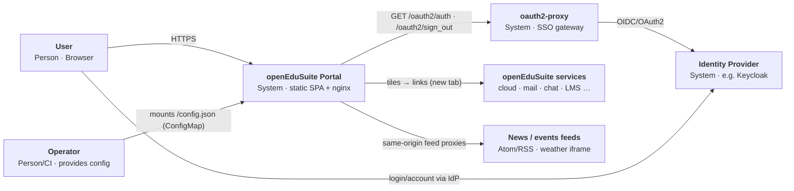
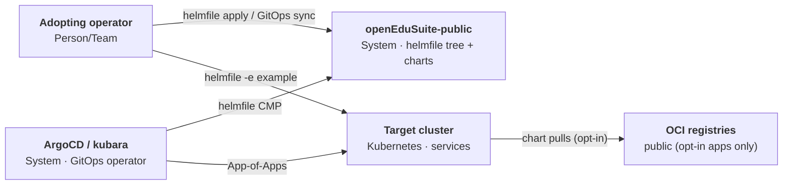

<!--
SPDX-FileCopyrightText: 2026 openEduSuite Contributors
SPDX-License-Identifier: Apache-2.0
-->

# 3. Context and Scope

The distribution spans **two cooperating systems**: the **portal** (the
product an operator runs for its users) and the **platform-as-code artifact**
(the deployment variants an operator applies to a Kubernetes cluster).

## 3.1 System Context — Portal

- **User** reaches the portal through a browser. The portal probes
  `/oauth2/auth` to learn the SSO state.
- **oauth2-proxy** terminates authentication in front of the portal; without
  it the portal only ever shows the landing page.
- **Identity Provider** (e.g. Keycloak) issues the session behind oauth2-proxy.
- **openEduSuite services** are presented as tiles; the portal itself only
  links to them.
- **Feeds** (news/events, weather) are fetched same-origin through nginx
  proxies, avoiding CORS.
- **Operator** supplies the runtime configuration (`/config.json`) and the
  deployment environment.

## 3.2 Context — Platform-as-Code (deployment variants)

- The **helmfile tree** (`helmfile/`) is the single source of truth for the 27
  app variants; it renders against the placeholder `example` environment.
- The **GitOps wrappers** (`argocd/`, `kubara/`) add the operator on top but
  render exactly the same helmfiles — no second deployment format.
- Everything except the two opt-in apps is fully offline-capable.

## 3.3 Scope

**In scope:** the portal frontend, its runtime configuration contract, the
sanitized helmfile app variants, local/vendored charts, and the GitOps
wrappers (ArgoCD App-of-Apps + kubara bootstrap).

**Out of scope:** the backchannel/integration services of the production
deployment (keycloak bootstrap, provisioning, data-loader, backchannel), the
production operator's cluster specifics, and hosted services.

---

[Back to index](./README.md)
