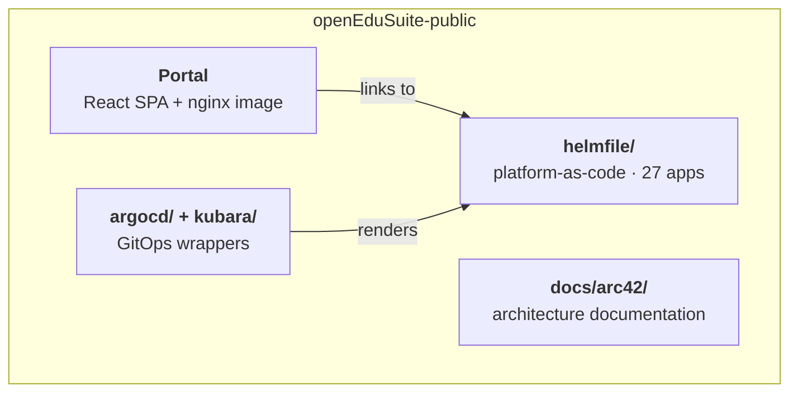

<!--
SPDX-FileCopyrightText: 2026 openEduSuite Contributors
SPDX-License-Identifier: Apache-2.0
-->

# 5. Building Block View

## 5.1 Level 1 — Whitebox

| Building block | Responsibility |
|----------------|----------------|
| **Portal** (`src/`, `public/`) | Configurable service dashboard, SSO-aware, i18n, widgets |
| **helmfile/** | Sanitized deployment variants: 27 app releases, 24 local charts, 4 vendored charts, `example` environment |
| **argocd/**, **kubara/** | GitOps delivery: App-of-Apps wrapper and kubara platform bootstrap |
| **docs/arc42/** | This architecture documentation |

## 5.2 Level 2 — Portal

| Block | Responsibility |
|-------|----------------|
| **Config loader** (`src/config.ts`) | Fetches `/config.json` (`cache: no-store`), falls back to `src/config.default.json`, exposes types |
| **Home page** (`src/pages/Home.tsx`) | Header (SSO state, theme, language), hero, sections/tiles, widgets, footer |
| **ServiceCard** (`src/components/`) | One tile: localized name/description, SSO badge, launch link |
| **NewsFeeds / WeatherWidget** | Same-origin Atom/RSS cards and weather iframe |
| **i18n** (`src/i18n.ts`, `src/locales/`) | de/en/fr/zh, browser detection + persisted switcher |
| **Theme** (`src/theme.ts`) | Light/dark, OS preference default, persisted |
| **nginx** (`nginx.conf.template`) | SPA serving, envsubst feed proxies, `/ping` + `/health` |

## 5.3 Level 2 — Platform-as-Code

| Block | Content / Responsibility |
|-------|--------------------------|
| `helmfile/apps/edu/<app>/` | 27 app variants (one release + values per app) |
| `helmfile/charts/` | 24 local charts incl. `common` library, `blackbox-probes`, `opentelemetry-collector`, `tempo` |
| `helmfile/vendor/charts/` | 4 vendored upstream charts: `jupyterhub`, `code-server`, `ollama`, `open-webui` |
| `helmfile/environments/example.yaml` | Placeholder environment (domains, realm, OIDC, secrets `CHANGEME`) |
| `helmfile/helmfile.yaml.gotmpl` | Root helmfile: defines `example` env, globs `apps/edu/*` |

App release groups (representative):

| Group | Apps |
|-------|------|
| Collaboration | bigbluebutton, drawio, etherpad, excalidraw, jupyterhub, kasmvnc*, overleaf*, rstudio, slidev, ttyd |
| LMS / knowledge | bookstack, ilias, limesurvey, moodle, planka, typo3, zammad |
| Files / groupware | opencloud, sogo, snipr |
| AI / automation | n8n, ollama, open-webui |
| DMS / tools | mayan-edms, paperless-ngx, code-server |
| Observability | monitoring (blackbox-probes), `opentelemetry-collector`/`tempo` charts |

\* opt-in apps pulling from public OCI registries (disabled in `example`).

## 5.4 Level 2 — GitOps Wrappers

| Block | Responsibility |
|-------|----------------|
| `argocd/openedusuite-apps/` | App-of-Apps chart: renders one `Application` per service (sync waves 1, 5) |
| `argocd/cmp-helmfile.yaml` | Helmfile Config Management Plugin (CMP v2, sidecar) |
| `argocd/cmp-repo-server.yaml` | repo-server sidecar/init patch (installs helm + helmfile) |
| `argocd/root-application.yaml` | Root Application to apply after CMP install |
| `kubara/config.yaml.example` | kubara cluster config (bootstraps ArgoCD + platform components) |

---

[Back to index](./README.md)
