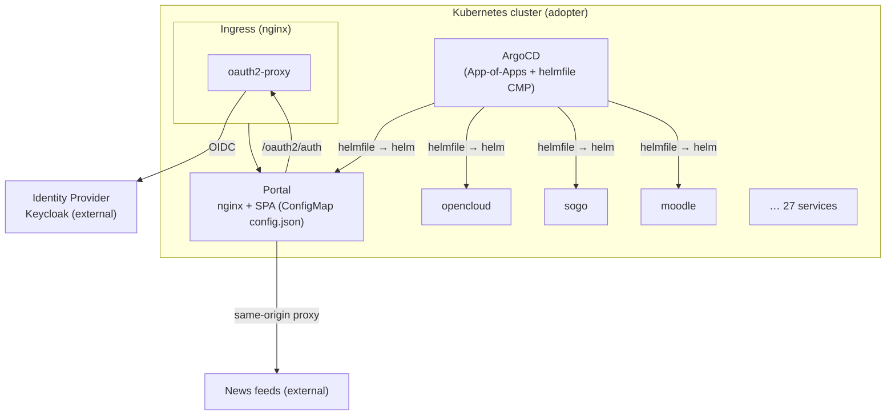

<!--
SPDX-FileCopyrightText: 2026 openEduSuite Contributors
SPDX-License-Identifier: Apache-2.0
-->

# 7. Deployment View

## 7.1 Runtime topology (target cluster)

## 7.2 Deployment options

| Option | Steps | Effort |
|--------|-------|--------|
| **A — Portal only** | Build/pull `openedusuite-portal` image, Ingress in front of oauth2-proxy, mount `config.json` (ConfigMap) | Minutes (see [portal deployment guide](../portal-deployment.md)) |
| **B — Platform via helmfile** | Edit `helmfile/environments/example.yaml`, run `helmfile -e example apply` | One-time env setup |
| **C — Platform via ArgoCD** | Install helmfile CMP, apply `argocd/root-application.yaml` | ArgoCD + CMP required |
| **D — Platform via kubara** | `kubara bootstrap`, then same as C | kubara CLI + platform components |

## 7.3 Artifacts

| Artifact | Where | Notes |
|----------|-------|-------|
| Portal image | Built from `Dockerfile` (`npm test` gate) → nginx | `npm run build` emits `dist/` |
| Local charts | `helmfile/charts/` (24) | Mostly headless, self-contained |
| Vendored charts | `helmfile/vendor/charts/` (4) | `jupyterhub`, `code-server`, `ollama`, `open-webui` |
| OCI charts (opt-in) | `kasmvnc`, `overleaf` | Public registries, disabled in `example` |
| Config contract | `/config.json` | Runtime mount, `cache: no-store` |

## 7.4 Node/physical distribution

The distribution is artifact-based (no managed nodes). A minimal physical
layout: one Kubernetes cluster (adopter-owned) running the portal plus the
chosen services; the IdP may be external or in-cluster; ArgoCD/kubara run
in-cluster; feeds/weather are external HTTP(S) resources.

---

[Back to index](./README.md)
