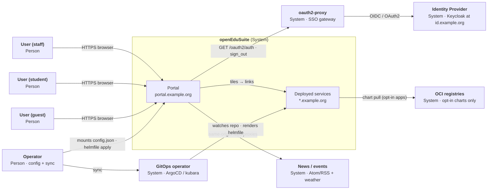

<!--
SPDX-FileCopyrightText: 2026 openEduSuite Contributors
SPDX-License-Identifier: Apache-2.0
-->

# C4 — Level 1: System Context (openEduSuite)

> **Focus:** the openEduSuite distribution as a whole — the portal and the
> platform-as-code artifact — in its environment. Maps to arc42
> [§3 Context and Scope](../03-context-and-scope.md).

## Explanation

- **Users** reach the portal via the browser; the portal links to all deployed
  services (`cloud.`, `mail.`, `lms.`, …) without hosting them.
- **Authentication** is delegated to oauth2-proxy in front of the portal.
- **Platform services** are delivered either imperatively (helmfile) or via
  the GitOps operator — both render the same helmfile tree.
- **OCI registries** are only contacted for the two opt-in apps
  (kasmvnc, overleaf).

---

[Back to the C4 models](./README.md)
