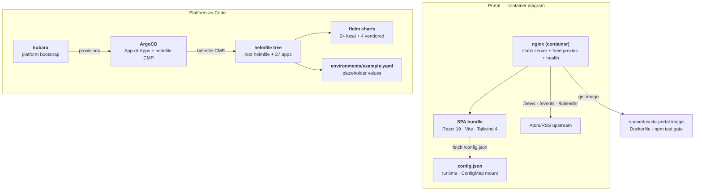

<!--
SPDX-FileCopyrightText: 2026 openEduSuite Contributors
SPDX-License-Identifier: Apache-2.0
-->

# C4 — Level 2: Container (openEduSuite)

> **Focus:** the containers/deployables of the distribution and their
> technologies. Maps to arc42 [§5 Building Block View](../05-building-block-view.md).

## Containers

| Container | Technology | Responsibility |
|-----------|-----------|----------------|
| **nginx** | `nginx.conf.template` + envsubst | Serves the SPA, proxies feeds same-origin, health endpoints |
| **SPA bundle** | React 19, Vite 8, Tailwind 4, i18next | Dashboard UI, config load, SSO probe, widgets |
| **config.json** | JSON (ConfigMap) | Runtime contract between operator and portal |
| **helmfile tree** | helmfile yaml.gotmpl | Deployment substrate for 27 services |
| **Helm charts** | local / vendored | Package the manifests per service |
| **ArgoCD** | operator + helmfile CMP | GitOps delivery of the platform |
| **kubara** | IDP bootstrap | ArgoCD + platform components provisioning |

---

[Back to the C4 models](./README.md)
