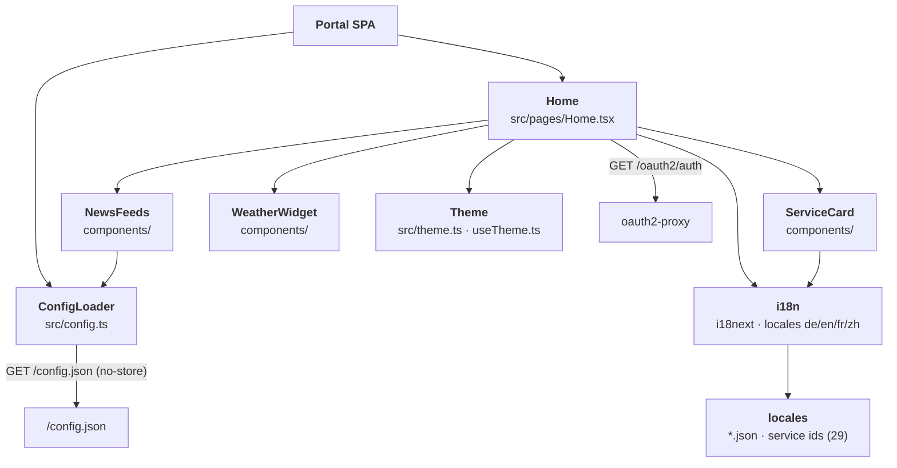

<!--
SPDX-FileCopyrightText: 2026 openEduSuite Contributors
SPDX-License-Identifier: Apache-2.0
-->

# C4 — Level 3: Component (openEduSuite Portal)

> **Focus:** the components of the portal frontend — the only first-class code
> component in the distribution. Maps to arc42
> [§5.2 Level 2 — Portal](../05-building-block-view.md#52-level-2--portal).

## Components

| Component | Responsibility | Notable behavior |
|-----------|----------------|------------------|
| **ConfigLoader** | Fetch + validate runtime config; fallback to `src/config.default.json` | `cache: no-store`; portability test |
| **Home** | Page assembly: header (SSO/theme/language), hero, sections/tiles, widgets, footer | Landing vs. signed-in render |
| **ServiceCard** | One service tile | Localized name/description, SSO badge, new-tab launch |
| **NewsFeeds** | Same-origin Atom/RSS cards | `FEED_*` proxy paths, `max` entries |
| **WeatherWidget** | Weather iframe | External `src`, i18n title |
| **i18n** | Language resolution + t() | Browser detection, persisted switcher, key-completeness test |
| **Theme** | Light/dark theme | OS default, persisted override |

---

[Back to the C4 models](./README.md)
